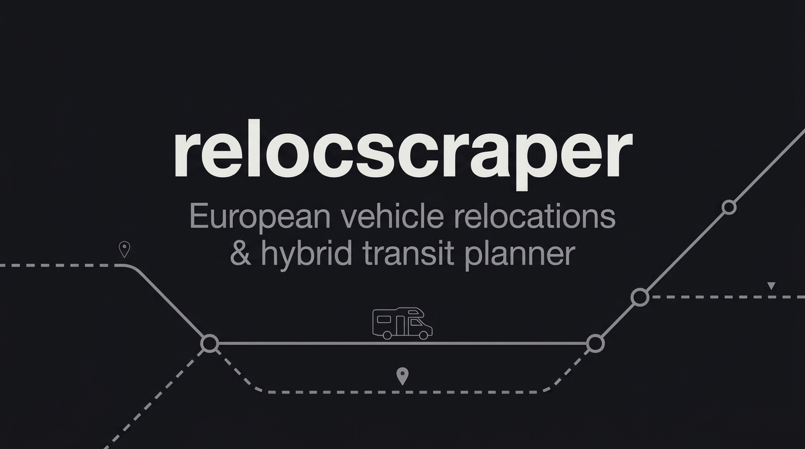

<p align="center">
  
</p>

# relocscraper 🚐🚗

> Automated CLI tool and agent framework to scrape, display, filter, sort, and monitor **rental vehicle relocations across Europe** from **indiecampers.com**, **movacar.de**, **driiveme.com**, **imoova.com**, and **carlundcarla.de**.

Structured with **markdown-described modes** inspired by agent-native CLI tools like [`career-ops`](https://github.com/santifer/career-ops).

---

## What is a Rental Relocation?

Car and campervan rental companies frequently need vehicles repositioned from one city or country to another due to one-way customer journeys or seasonal fleet rebalancing. Rather than paying transport carriers, they offer these trips to travelers for **1.00 € total**, **1.00 € per day**, or even **0.00 € (completely free)**, often including generous mileage allowances and fuel or ferry subsidies.

`relocscraper` aggregates these deals into a unified, normalized database with terminal viewing, filtering, sorting, statistics, and change monitoring.

---

## Supported Providers

| Provider | Portal | Region | Inventory Focus | Typical Rate |
|---|---|---|---|---|
| **Indie Campers** | [indiecampers.com](https://indiecampers.com) | 18+ European Countries | Campervans & Pop-up RVs (Nomad, Active Plus, Atlas) | 1€ / day specials |
| **Movacar** | [movacar.de](https://movacar.de) | Germany & Europe | Cars, Transporters, Campers (incl. Carl und Carla) | 1.00 € total |
| **Ugoki** (FlipCar) | [ugoki.com](https://ugoki.com) | Germany & Alpine routes | 1€ cars & vans (Sixt depot transfers with 1st tank, MILES on-street carsharing) | 1.00 € total |
| **Driiveme** | [driiveme.com](https://driiveme.com) | FR, DE, ES, IT, PT, UK | 1€ One-way cars & utility vans (6m³-20m³) | 1.00 € total |
| **Imoova** | [imoova.com](https://imoova.com) | Western & Southern Europe | European Campervans & Motorhomes | 1.00 € / day |

---

## Modes Architecture (`modes/`)

Similar to `career-ops`, each capability and workflow is formally specified in a dedicated Markdown file inside the `modes/` directory:

| Mode File | CLI Mode | Purpose |
|---|---|---|
| [`modes/scan.md`](modes/scan.md) | `scan` | Scrapes all 5 platforms concurrently with caching and offline fallback |
| [`modes/display.md`](modes/display.md) | `display` | Displays formatted ANSI terminal tables with colored price & provider badges |
| [`modes/filter.md`](modes/filter.md) | `filter` | Multi-criteria filtering (origin, destination, vehicle, seats, price, perks) |
| [`modes/sort.md`](modes/sort.md) | `sort` | Multi-field sorting (price, dates, duration, seats, origin, destination) |
| [`modes/route.md`](modes/route.md) | `route` | Hybrid D-Ticket + 1€ relocation optimizer (finds faster trips) |
| [`modes/detail.md`](modes/detail.md) | `detail` | Deep-dive specification sheet for an individual offer and depot address |
| [`modes/stats.md`](modes/stats.md) | `stats` | European market analytics, top corridors, and provider breakdown |
| [`modes/watch.md`](modes/watch.md) | `watch` | Automated recurring monitor detecting newly added routes |
| [`modes/export.md`](modes/export.md) | `export` | Exports listings to JSON, CSV, or formatted Markdown digest |
| [`modes/book.md`](modes/book.md) | `book` | Pre-flight reservation checklist and direct booking portal URL |
| [`modes/_shared.md`](modes/_shared.md) | System Context | Data schema, country normalization, vehicle taxonomy |
| [`modes/_custom.md`](modes/_custom.md) | User Context | User standing preferences and house rules |

---

## Quickstart

### Installation

Requires Node.js >= 20 (Node 22 or 26 recommended):

```bash
git clone <repo-url>
cd relocscraper
npm install
```

Make the CLI available globally or use `./reloc`:

```bash
npm link
# Now you can run `reloc` from anywhere!
```

---

## CLI Usage

### 1. Scrape Live Relocations (`scan`)

```bash
# Scrape all 5 European providers
reloc scan

# Or scrape a specific provider
reloc scan --provider imoova
reloc scan --provider movacar
```

### 2. Display Listings Table (`display` / `list`)

```bash
# View table of current deals (default 50 rows)
reloc display

# Limit rows
reloc display --limit 15

# Quick filter directly during display
reloc display --origin Germany --destination Portugal
```

### 3. Filter Relocations (`filter`)

```bash
# Filter by departure city or country
reloc filter --origin Berlin
reloc filter --origin Germany
reloc filter --origin France

# Filter by destination
reloc filter --destination Spain
reloc filter --destination Lisbon

# Filter by vehicle category (campervan | van | car | motorhome)
reloc filter --vehicle campervan

# Filter by passenger seats
reloc filter --seats 4

# Show only 0.00 € free relocations
reloc filter --free

# Show only cross-border European routes
reloc filter --cross-border

# Filter by included perks
reloc filter --fuel     # routes with fuel allowance
reloc filter --ferry    # routes with ferry ticket reimbursement
```

### 4. Sort Relocations (`sort`)

```bash
# Sort by price (cheapest first)
reloc sort price asc

# Sort by allowed trip duration (longest road trips first)
reloc sort duration desc

# Sort by earliest departure date
reloc sort date asc

# Sort by passenger capacity
reloc sort seats desc
```

### 5. Deutschlandticket + 1€ Relocation Route Optimizer (`route`)

Combines free regional transit (RE, RB, S-Bahn) with high-speed 1€ relocations to find trips that are significantly faster than pure regional trains at virtually zero extra cost:

```bash
# Calculate fastest hybrid routes between two cities
reloc route Berlin Hamburg
reloc route Berlin Köln
reloc route Frankfurt Berlin

# Filter only routes with 1st tank / fuel included (e.g. Sixt depot transfers via Ugoki)
reloc route Berlin Hamburg --fuel-only

# Filter for a specific pickup date
reloc route Berlin Hamburg --date 2026-11-10

# Pass verified vehicle range from your MILES app to calculate exact fuel top-up
reloc route Berlin Giessen --range 335
```

### 6. Inspect Deal Details (`detail`)

Displays full technical and booking specifications for any relocation deal, including depot addresses, free kilometer allowances, return rules, and fuel policies:

```bash
# Inspect any relocation deal
reloc detail imoova_RLC129937
reloc detail ugoki_123456

# Inspect a MILES on-street transfer with your verified app stats
reloc detail ugoki_123456 --range 320 --fuel 50% --car "VW Golf" --plate "B-MI 1234"
```

Output with verified vehicle telematics:
```text
════════════════════════════════════════════════════════════
🚘 RELOCATION OFFER: ugoki_123456
════════════════════════════════════════════════════════════
Provider:      Ugoki (MILES)
Origin:        Berlin, Germany
               Hauptstraße 10 
Destination:   Frankfurt am Main, Germany
               MILES Service Area 
Vehicle:       Car [🚗 Car] (automatic)
Capacity:      5 Seats 
Trip Duration: 1 days (6 hours)
Pickup Window: 2026-11-10 → 2026-11-16
Deliver By:    2026-11-16
Price:         1.00 EUR (total base rate)
Free Km:       546 km included
Fuel Policy:   Starts with current on-street tank level as-is. 
               Extra fuel needed for trip is paid by driver.
════════════════════════════════════════════════════════════
🚘 VERIFIED VEHICLE TELEMATICS (Cross-Referenced via MILES App):
  • Exact Vehicle:   VW Golf [B-MI 1234]
  • Verified Fuel:   50% (320km range)
  • Transmission:    Automatic
Booking Link:  https://ugoki.com
════════════════════════════════════════════════════════════
```

### 7. Market Intelligence & Corridors (`stats`)

```bash
reloc stats
```

Output:
```text
📊 EUROPEAN RENTAL RELOCATIONS SUMMARY
──────────────────────────────────────────────────
Total Available Relocations: 314
Free (0.00 €) Trips:        1
1 Euro Trips:               309
Average Trip Duration:      1.8 days

📡 Breakdown by Provider:
  • [Movacar]: 100
  • [Imoova]: 36
  • [Driiveme]: 72
  • [Indie Campers]: 19
  • [Carl&Carla]: 87

⭐ Popular Corridors:
  • Milan → Lisbon: 11 vehicles
  • Kassel → Guxhagen: 10 vehicles
  • Bilbao → Lisbon: 7 vehicles
  • Regensburg → Deggendorf: 8 vehicles
  • München → Laupheim: 8 vehicles
```

### 8. Background Watcher & Change Alerts (`watch`)

```bash
# Single monitoring pass comparing against previous snapshot
reloc watch --once

# Recurring daemon watching every 5 minutes
reloc watch --interval 300
```

### 9. Export to CSV, JSON, or Markdown (`export`)

```bash
# Export to CSV (open in Excel / Google Sheets)
reloc export --format csv --output data/relocations.csv

# Export to GitHub Flavored Markdown
reloc export --format md --output data/relocations.md

# Export filtered subset (e.g., campervans to Portugal)
reloc export --format md --vehicle campervan --destination Portugal --output data/campers.md
```

### 10. Pre-Flight Booking Checklist (`book`)

```bash
reloc book imoova_RLC129937
```

---

## Configuration (`config/preferences.yml`)

Customize your home location, target destinations, and alert rules in `config/preferences.yml` or `modes/_custom.md`:

```yaml
user:
  home_country: "DE"
  home_city: "Berlin"
  favorite_destinations:
    - "Spain"
    - "Portugal"
    - "Italy"

filters:
  max_price_eur: 5.0
  min_seats: 2
  vehicle_types:
    - "campervan"
    - "van"
    - "car"
```

---

## Testing

Run the full end-to-end test suite:

```bash
npm test
```

Runs:
- `scripts/check-privacy.mjs`: Privacy & secret leak guard.
- `tests/providers.test.mjs`: Tests scraping and normalization against Indie Campers, Movacar, Driiveme, Imoova, Ugoki (FlipCar).
- `tests/filter-sort.test.mjs`: Unit tests for multi-parameter filtering and ranking.
- `tests/router.test.mjs`: Hybrid route optimizer, dynamic OSM geocoding, and transit timetable engine.
- `tests/miles.test.mjs`: Verified vehicle telematics resolver and fuel deficit calculation.
- `tests/cli.test.mjs`: Integration tests for all CLI mode commands.

---

## Acknowledgments & Data Sources

- **Geocoding & Map Data**: [OpenStreetMap](https://www.openstreetmap.org/copyright) contributors (licensed under [ODbL](https://opendatacommons.org/licenses/odbl/)) via [Nominatim](https://nominatim.org) and [Komoot Photon](https://photon.komoot.io).
- **Public Transit Timetables**: [MOTIS Project](https://motis-project.de) (Algorithm Engineering Group, TU Darmstadt) for European GTFS rail timetable calculations.
- **Architectural Paradigm**: Modeled after the agentic workflow standards of `career-ops`.

---

## Disclaimer

This is an independent open-source research and productivity tool. It is not affiliated with, authorized, maintained, or endorsed by Indie Campers, Movacar, Driiveme, Imoova, Ugoki, FlipCar, MILES Mobility, Sixt, Deutsche Bahn, or any of their affiliates. All product and company names are trademarks™ or registered® trademarks of their respective holders.

---

## License

MIT © 2026 relocscraper Contributors
