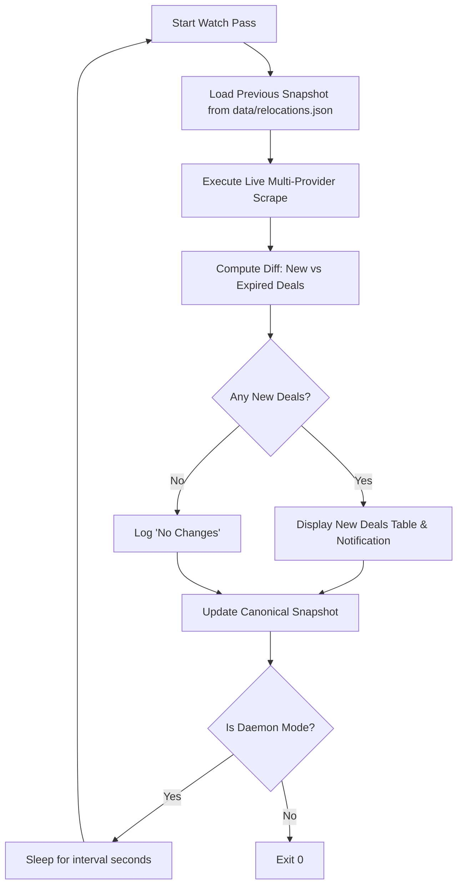

# Mode: watch — Automated Monitor & Alert Daemon

Monitors the 5 European rental relocation platforms on a recurring cadence, performs differential comparison against prior snapshots, and surfaces newly listed routes.

## CLI Invocation

```bash
# Run a single monitoring pass and exit
reloc watch --once

# Run daemon with periodic interval (e.g. every 5 minutes / 300 seconds)
reloc watch --interval 300
```

## Operational Flow



## Diff Logic

- Deals present in the current scrape but absent in `data/relocations.previous.json` are classified as **NEW DEALS**.
- Expired or reserved deals that disappeared are logged as **DROPPED DEALS**.
- Notifications can be filtered according to `config/preferences.yml` criteria (e.g., alert only on routes heading to Portugal or Italy).
